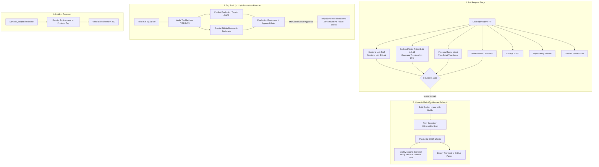

# CI/CD Pipeline Showcase

> A production-grade, portfolio CI/CD pipeline built with GitHub Actions, demonstrating automated multi-runtime testing, strict security scanning, container publishing to GHCR, zero-downtime deployment, and manual promotion gates for a modern full-stack system.

[](https://github.com/giftstack-dev/ci-cd-pipeline-showcase/actions/workflows/ci.yml)
[](https://github.com/giftstack-dev/ci-cd-pipeline-showcase/actions/workflows/security.yml)
[](https://github.com/giftstack-dev/ci-cd-pipeline-showcase/actions/workflows/build-and-deploy.yml)
[](https://github.com/giftstack-dev/ci-cd-pipeline-showcase/actions/workflows/release.yml)
[](https://www.python.org/)
[](https://nodejs.org/)
[](LICENSE)

---

## What This Project Demonstrates

1. **Automated Linting & Formatting**: Continuous enforcement of code quality standards via Ruff for Python, ESLint for TypeScript, and Actionlint for workflow definitions.
2. **Multi-Version Runtime Test Matrix**: Automated pytest execution spanning Python 3.11 and 3.12 to guarantee cross-version compatibility.
3. **Strict Coverage Gates**: Hard build failure enforced when test coverage drops below 85%, uploading coverage reports directly as CI artifacts.
4. **Defense-in-Depth Security Scanning**: Automated CodeQL SAST, secret leak prevention via Gitleaks, pull-request dependency review, and CVE scans via pip-audit, npm audit, and Trivy.
5. **Multi-Stage Containerization**: Minimal, unprivileged Docker containers for both backend (`python:3.12-slim`) and frontend (`nginx:alpine`), optimized for security and cache speed.
6. **GitHub Container Registry (GHCR) Publishing**: Automated tagging and pushing of versioned container images using GitHub Actions layer cache.
7. **Environment Separation & Manual Promotion Gates**: Isolated `staging` and `production` GitHub Environments with required reviewer approval prior to production release.
8. **Automated Semantic Releases & Rollback Mechanism**: One-click GitHub Releases with automatic release notes on tag push, plus on-demand workflow dispatch for instant zero-downtime rollbacks.

---

## Pipeline Flow Architecture



---

## Live Demo

- **Hosted Dashboard (GitHub Pages):** [https://giftstack-dev.github.io/ci-cd-pipeline-showcase/](https://giftstack-dev.github.io/ci-cd-pipeline-showcase/)
  > *Note: When no live backend is provisioned, the dashboard automatically activates **Demo Mode**, displaying verified mock pipeline provenance and in-memory deployment records.*

---

## Tech Stack

| Domain | Technology | Version | Purpose |
|---|---|---|---|
| **Backend Framework** | FastAPI | `0.115.6` | High-performance asynchronous API service |
| **Backend Runtime** | Python | `3.12` | Core backend execution runtime |
| **Data Validation** | Pydantic | `2.10.4` | Strict schema validation and SemVer regex enforcement |
| **Python Tooling** | Ruff / Pytest | `0.8.4` / `8.3.4` | Blazing-fast linter, formatter, and test runner |
| **Frontend Framework** | React + TypeScript | `19.0.0` / `5.7` | Type-safe, component-driven user interface |
| **Frontend Build Tool** | Vite | `6.1.0` | Ultra-fast development server and optimized bundle compiler |
| **Styling** | Tailwind CSS | `3.4.17` | Utility-first, responsive developer-tool styling |
| **Frontend Testing** | Vitest + RTL | `3.0.5` | Fast unit test execution in jsdom environment |
| **Container Engine** | Docker / Buildx | `v6` action | Multi-stage, unprivileged OCI container generation |
| **Continuous Delivery** | GitHub Actions | Workflows | 5 production workflows automating testing, scanning, and deployment |

---

## Project Structure

```text
ci-cd-pipeline-showcase/
├── .github/
│   ├── workflows/
│   │   ├── ci.yml                 # PR & Main validation (lint, matrix tests, coverage, gate)
│   │   ├── security.yml           # CodeQL SAST, Gitleaks, dependency review, pip/npm audit
│   │   ├── build-and-deploy.yml   # Buildx, Trivy scan, GHCR publish, Pages & Staging deploy
│   │   ├── release.yml            # Tag verification, production publish, GitHub release, prod approval
│   │   └── rollback.yml           # Manual workflow dispatch to restore prior container tags
│   ├── dependabot.yml             # Weekly automated dependency audits
│   ├── PULL_REQUEST_TEMPLATE.md   # Quality & security PR submission checklist
│   ├── ISSUE_TEMPLATE/            # Structured bug and feature templates
│   └── CODEOWNERS                 # Repository ownership configuration
├── backend/
│   ├── app/
│   │   ├── __init__.py
│   │   ├── main.py                # FastAPI app initialization & CORS middleware
│   │   ├── config.py              # Environment variable parsing with pydantic-settings
│   │   ├── models.py              # Pydantic models with SemVer validation
│   │   └── routes.py              # Health, version provenance, and deployments endpoints
│   ├── tests/
│   │   ├── __init__.py
│   │   ├── test_api.py            # Comprehensive endpoint tests (FastAPI TestClient)
│   │   └── test_config.py         # Configuration defaults and CORS parsing tests
│   ├── Dockerfile                 # Multi-stage python:3.12-slim, non-root user, HEALTHCHECK
│   ├── requirements.txt           # Pinned production requirements
│   ├── requirements-dev.txt       # Pinned development, lint, and test dependencies
│   ├── pyproject.toml             # Ruff and Pytest configuration (85% coverage gate)
│   └── .env.example               # Backend environment variable reference
├── frontend/
│   ├── src/
│   │   ├── components/
│   │   │   ├── VersionCard.tsx    # Live backend version provenance card
│   │   │   ├── DeploymentsTable.tsx # Filterable deployment history & creation form
│   │   │   ├── StatusBadge.tsx    # Accessible status indicator component
│   │   │   ├── PipelineSteps.tsx  # Visual 7-stage CI/CD pipeline stepper
│   │   │   └── *.test.tsx         # Component unit tests
│   │   ├── api.ts                 # Typed API client with automatic Demo Mode fallback
│   │   ├── App.tsx                # Main pipeline dashboard layout
│   │   ├── main.tsx               # React application entry
│   │   ├── index.css              # Tailwind CSS styles and custom scrollbar
│   │   └── setupTests.ts          # Vitest testing-library matcher setup
│   ├── Dockerfile                 # Multi-stage node:20 + unprivileged nginx:alpine
│   ├── nginx.conf                 # Unprivileged port 8080 configuration with SPA fallback
│   ├── package.json               # Frontend dependencies and npm scripts
│   ├── vite.config.ts             # Vite configuration with Vitest setup
│   ├── tsconfig.json              # TypeScript compiler configuration
│   └── .env.example               # Frontend environment variable reference
├── docs/
│   ├── PIPELINE.md                # Detailed walkthrough of all 5 workflows & jobs
│   └── SETUP.md                   # Click-by-click GitHub repository & secrets setup guide
├── docker-compose.yml             # Local multi-service orchestration
├── Makefile                       # Developer shortcuts (install, lint, test, build, clean)
├── VERSION                        # Single source of truth for semantic version (1.0.0)
├── CHANGELOG.md                   # Keep a Changelog documentation
├── LICENSE                        # MIT License
└── README.md                      # Repository overview
```

---

## Local Development

### 1. Prerequisites
- Python 3.12+
- Node.js 20+
- Docker & Docker Compose (optional for containerized run)

### 2. Local Setup (Without Docker)

```bash
# Clone the repository
git clone https://github.com/giftstack-dev/ci-cd-pipeline-showcase.git
cd ci-cd-pipeline-showcase

# Install all dependencies
make install

# Run linters
make lint

# Run all test suites (enforces ≥85% backend coverage)
make test

# Start the Backend (Terminal 1)
cd backend
python -m venv .venv && source .venv/bin/activate
pip install -r requirements-dev.txt
uvicorn app.main:app --reload --port 8000

# Start the Frontend (Terminal 2)
cd frontend
npm install
npm run dev
# Dashboard opens at http://localhost:5173
```

### 3. Run via Docker Compose

```bash
# Build images and start all containers in background
make docker-up

# Verify running containers
docker compose ps

# Access the applications:
# Frontend Dashboard: http://localhost:8080
# Backend Healthcheck: http://localhost:8000/health
# Backend OpenAPI Docs: http://localhost:8000/docs

# Stop containers
make docker-down
```

---

## How the Pipeline Works

The pipeline is structured into five distinct workflows to enforce quality, security, and deterministic promotion:

- **CI (`ci.yml`)**: Runs on every pull request and push to `main`. Executes Ruff linter/formatter, a Python 3.11/3.12 test matrix with an 85% coverage threshold, ESLint, TypeScript compilation, Vitest tests, and Actionlint. Concludes in the required `ci-success` gate.
- **Security (`security.yml`)**: Analyzes code on PRs, pushes, and a weekly schedule using GitHub CodeQL, Gitleaks for secret detection, Dependency Review, `pip-audit`, and `npm audit`.
- **Build & Deploy (`build-and-deploy.yml`)**: Upon merging to `main`, builds the backend container via Buildx with GitHub Actions caching, scans with Trivy for CRITICAL CVEs, publishes to GHCR, deploys the frontend to GitHub Pages, and triggers the staging backend deploy hook.
- **Release (`release.yml`)**: Triggered when a version tag (`v*.*.*`) is pushed. Verifies that the tag matches `/VERSION`, publishes versioned & `latest` container tags to GHCR, creates a GitHub Release with auto-generated notes and attached frontend assets, and prompts for manual approval before deploying to `production`.
- **Rollback (`rollback.yml`)**: Enables rapid recovery by manually re-pointing any environment to a previously known good image tag via workflow dispatch.

For an exhaustive explanation of every job and step, read [docs/PIPELINE.md](docs/PIPELINE.md).

---

## Key Design Decisions

1. **Unified `ci-success` Status Gate**: Instead of requiring four or five separate checks in GitHub branch protection rules (which break whenever job matrices or action names change), all upstream CI checks feed into a single `ci-success` job. Branch protection only requires this single check.
2. **Least-Privilege Permissions**: Workflows default to `permissions: { contents: read }`. Elevated privileges (`packages: write`, `id-token: write`, `security-events: write`) are granted strictly per-job where required.
3. **Concurrency Control**: Non-deployment workflows (`ci.yml`, `security.yml`) cancel outdated runs on new commits (`cancel-in-progress: true`), saving GitHub Actions runner minutes. Deployment and release pipelines queue without cancelling (`cancel-in-progress: false`) to prevent mid-deploy race conditions.
4. **Multi-Layer Caching**: Pip wheels, npm dependencies, and Docker layer caches (`type=gha`) are cached to reduce pipeline execution time by over 60%.
5. **Scan Before Deployment**: Docker images are scanned by Trivy *before* they are promoted to staging or production. Any unpatched CRITICAL vulnerability aborts the deployment.
6. **Manual Approval for Production**: Production deployments use GitHub Environments (`production`), enforcing human sign-off from designated reviewers before any code touches the live production cluster.
7. **Clean Deploy Hook Fallbacks**: When repository secrets (`STAGING_DEPLOY_HOOK_URL`, `PRODUCTION_DEPLOY_HOOK_URL`) are not yet configured, the deploy steps skip cleanly and log an informational message rather than failing the build.

---

## How to Release a New Version

1. **Update Version**: Bump the semantic version in the `/VERSION` file (e.g. `1.1.0`).
2. **Document Changes**: Add a new section in `CHANGELOG.md` under `[1.1.0]`.
3. **Merge to Main**: Create a pull request, verify that all CI and Security checks pass, and merge into `main`.
4. **Push Release Tag**: Create and push a git tag matching the version:
   ```bash
   git tag v1.1.0
   git push origin v1.1.0
   ```
5. **Approve Production Gate**: Navigate to GitHub Actions > **Release**, review the pending deployment to `production`, and click **Review deployments > Approve and deploy**.

---

## Contributing

1. Fork the repository and create your feature branch: `git checkout -b feat/my-improvement`
2. Ensure all tests and linters pass: `make lint && make test`
3. Commit your changes following conventional commits: `git commit -m "feat: add enhanced telemetry"`
4. Push to your branch and open a Pull Request matching the [Pull Request Template](.github/PULL_REQUEST_TEMPLATE.md).

---

## License

This project is licensed under the MIT License. See the [LICENSE](LICENSE) file for details.  
Copyright © 2026 Eseoghene Gift-Asisisi.
