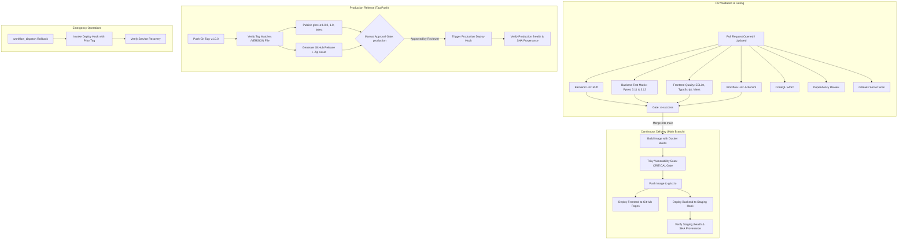

# Pipeline Architecture & Workflow Documentation

This document provides a comprehensive technical breakdown of every GitHub Actions workflow, job, and architectural principle implemented in `ci-cd-pipeline-showcase`.

---

## 1. Pipeline Overview & Mermaid Flowchart

The delivery pipeline consists of five automated GitHub Actions workflows operating in harmony across different stages of the software development lifecycle:

---

## 2. Workflow Deep-Dive

### 2.1 Workflow 1: Continuous Integration (`ci.yml`)

- **File Path:** `.github/workflows/ci.yml`
- **Triggers:**
  - `push` to `main` branch
  - `pull_request` targeting `main` branch
- **Concurrency:** Cancels outdated in-progress runs for the same ref (`cancel-in-progress: true`).
- **Default Permissions:** `contents: read`

#### Jobs:

#### `backend-lint`
- **Purpose:** Verifies that all Python code complies with PEP 8 and formatting standards without executing unverified code.
- **Tools:** [Ruff](https://astral.sh/ruff) (`ruff format --check backend` and `ruff check backend`).
- **Why it exists:** Ruff is 10-100x faster than traditional flake8/black tools, providing instantaneous feedback to developers.

#### `backend-test`
- **Purpose:** Executes automated unit and integration tests across a matrix of supported Python runtimes.
- **Matrix:** Python `3.11` and Python `3.12`.
- **Coverage Gate:** `--cov-fail-under=85`. If line or branch coverage drops below 85%, the build fails immediately.
- **Artifacts:** Generates and uploads `coverage.xml` for auditing.
- **Summary:** Posts a formatted test report directly to `$GITHUB_STEP_SUMMARY`.

#### `frontend-checks`
- **Purpose:** Validates frontend source integrity, type definitions, component tests, and production compilation.
- **Steps:**
  1. `npm ci` (deterministic dependency installation from lockfile).
  2. `npm run lint` (ESLint 9 rules with typescript-eslint).
  3. `npm run typecheck` (`tsc --noEmit` ensures zero TypeScript errors).
  4. `npm run test:coverage` (Vitest with jsdom and code coverage).
  5. `npm run build` (Vite static production bundle build).
- **Artifacts:** Uploads the compiled `frontend/dist` directory as `frontend-dist`.

#### `workflow-lint`
- **Purpose:** Validates the syntax, expression types, and action integrity of all GitHub Actions workflow files.
- **Tool:** [Actionlint](https://github.com/rhysd/actionlint).
- **Why it exists:** Catches workflow typos, missing context variables, and shell escaping errors before they fail on production branches.

#### `ci-success`
- **Purpose:** Serves as the single unified status check required by GitHub Branch Protection rules.
- **Condition:** `if: always()`, evaluates whether any upstream check failed or was cancelled.
- **Why it exists:** Decouples GitHub repository branch protection settings from changing job matrices. Adding or removing a Python version in the matrix never requires changing branch protection rules.

---

### 2.2 Workflow 2: Security & Vulnerability Auditing (`security.yml`)

- **File Path:** `.github/workflows/security.yml`
- **Triggers:**
  - `push` to `main`
  - `pull_request` to `main`
  - `schedule`: Weekly cron on Monday at 03:00 UTC (`0 3 * * 1`)
- **Default Permissions:** `contents: read`

#### Jobs:

#### `codeql`
- **Purpose:** Semantic Static Application Security Testing (SAST) analyzing source code for Common Weakness Enumerations (CWEs) such as SQL injection, XSS, insecure deserialization, and path traversal.
- **Languages:** `javascript-typescript` and `python`.
- **Permissions:** `security-events: write` (publishes results to GitHub Security tab).

#### `dependency-review`
- **Purpose:** Runs exclusively on `pull_request` to prevent developers from introducing packages with known high-severity vulnerabilities.
- **Action:** `actions/dependency-review-action@v4` with `fail-on-severity: high`.

#### `python-audit`
- **Purpose:** Scans the backend's pinned dependencies against the official PyPA Advisory Database using `pip-audit`.

#### `npm-audit`
- **Purpose:** Audits `frontend/` package dependencies with `npm audit --audit-level=high`.

#### `secret-scan`
- **Purpose:** Scans full git commit history for leaked API keys, tokens, private keys, or passwords using [Gitleaks](https://github.com/gitleaks/gitleaks).
- **Note:** Operates without commercial license requirements for personal and open-source repositories.

---

### 2.3 Workflow 3: Build & Continuous Deployment (`build-and-deploy.yml`)

- **File Path:** `.github/workflows/build-and-deploy.yml`
- **Triggers:**
  - `push` to `main` branch
  - `workflow_dispatch` (manual execution)
- **Concurrency:** Does not cancel in-progress runs (`cancel-in-progress: false`).

#### Jobs:

#### `build-image`
- **Purpose:** Builds an OCI container image for the backend service using Docker Buildx and publishes to GitHub Container Registry (`ghcr.io`).
- **Layer Caching:** Utilizes GitHub Actions cache backend (`cache-from: type=gha`, `cache-to: type=gha,mode=max`) for accelerated build times.
- **Build-Time Injections:** Injects `VERSION` (read from file), `COMMIT_SHA` (`github.sha`), and `BUILD_TIME` into the container image environment.
- **Vulnerability Scan:** Scans the newly generated image with [Trivy](https://github.com/aquasecurity/trivy-action). Fails the pipeline if unpatched `CRITICAL` vulnerabilities exist, and uploads a SARIF report to GitHub Advanced Security.

#### `deploy-frontend`
- **Purpose:** Deploys the React SPA to GitHub Pages.
- **Environment:** `github-pages`.
- **Provenance:** Injects `VITE_APP_VERSION`, `VITE_COMMIT_SHA`, `VITE_BUILD_TIME`, and `VITE_API_URL` (from `vars.STAGING_API_URL`).
- **Base Path:** Configured via `VITE_BASE_PATH=/ci-cd-pipeline-showcase/`.

#### `deploy-backend-staging`
- **Purpose:** Triggers a webhook deployment to the staging hosting environment (e.g., Render, Fly.io) and verifies health.
- **Skip Logic:** If the secret `STAGING_DEPLOY_HOOK_URL` is unset, the step logs an informational notice and exits with code 0 without failing.
- **Verification Loop:** When configured, polls `$STAGING_API_URL/health` up to 10 times with 15-second delays, and verifies that the deployed commit SHA matches the Git SHA.

---

### 2.4 Workflow 4: Tag-Based Production Release (`release.yml`)

- **File Path:** `.github/workflows/release.yml`
- **Triggers:**
  - `push` of git tags matching `v*.*.*` (e.g. `v1.0.0`, `v1.2.3`)
- **Concurrency:** Never cancelled.

#### Jobs:

#### `verify`
- **Purpose:** Validates release integrity before executing any deployment actions.
- **Check:** Extracts the version from the tag (`v1.2.0` -> `1.2.0`) and confirms that the contents of `/VERSION` exactly match. Fails with an instructive error message if there is a mismatch.

#### `publish-image`
- **Purpose:** Publishes production-tagged containers to `ghcr.io`.
- **Tags Created:**
  - Full version: `ghcr.io/giftstack-dev/ci-cd-pipeline-showcase-backend:1.0.0`
  - Major/Minor: `ghcr.io/giftstack-dev/ci-cd-pipeline-showcase-backend:1.0`
  - Latest: `ghcr.io/giftstack-dev/ci-cd-pipeline-showcase-backend:latest`

#### `github-release`
- **Purpose:** Creates an official GitHub Release using `gh release create`.
- **Assets:** Bundles the compiled frontend into a zip archive and attaches it to the release.
- **Release Notes:** Automatically compiles release notes from merged pull request titles and contributors.

#### `deploy-production`
- **Purpose:** Promotes the release to the live production environment.
- **Environment Gate:** Bound to GitHub Environment `production`. By assigning required reviewers in GitHub Repository Settings, this job pauses until a team lead approves the deployment in the GitHub UI.
- **Zero-Downtime Verification:** Triggers `PRODUCTION_DEPLOY_HOOK_URL`, polls `$PRODUCTION_API_URL/health` until 200 is confirmed, and verifies the active commit SHA.

---

### 2.5 Workflow 5: Disaster Recovery & Rollback (`rollback.yml`)

- **File Path:** `.github/workflows/rollback.yml`
- **Triggers:** `workflow_dispatch` (manual trigger with inputs)
- **Inputs:**
  - `environment`: Target environment (`staging` or `production`).
  - `image_tag`: Specific container tag to restore (e.g., `0.9.4` or `7f9c2d1`).
- **Mechanism:** Invokes the environment's deploy webhook with the target image tag as an argument, verifies health check recovery, and documents the incident recovery in the GitHub Step Summary.

---

### 2.6 Dependabot Automation (`dependabot.yml`)

- **File Path:** `.github/dependabot.yml`
- **Ecosystems Covered:**
  - `pip` (Backend Python packages)
  - `npm` (Frontend Node packages)
  - `github-actions` (Workflow actions)
  - `docker` (Backend Docker base images)
- **Schedule:** Weekly updates on Mondays.
- **Grouping:** Groups minor and patch updates into a single PR per ecosystem to minimize pull request noise.
- **Limit:** 5 open pull requests per package ecosystem.
